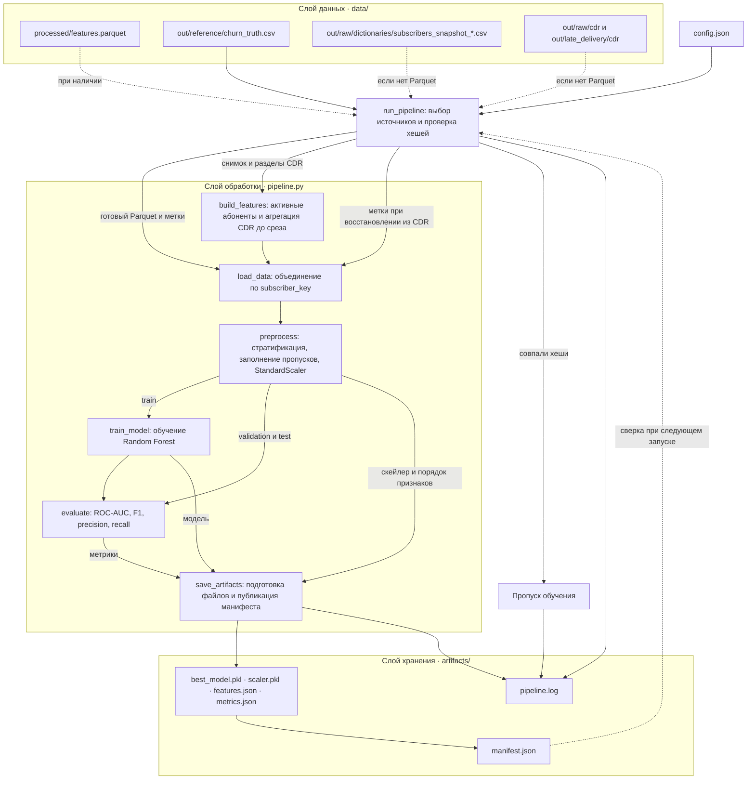

# Архитектура конвейера

При запуске в Docker каталог данных подключается в `/app/data`, а артефакты и журнал записываются в `/app/artifacts`. Оба пути соответствуют каталогам на хосте, указанным в команде запуска.
